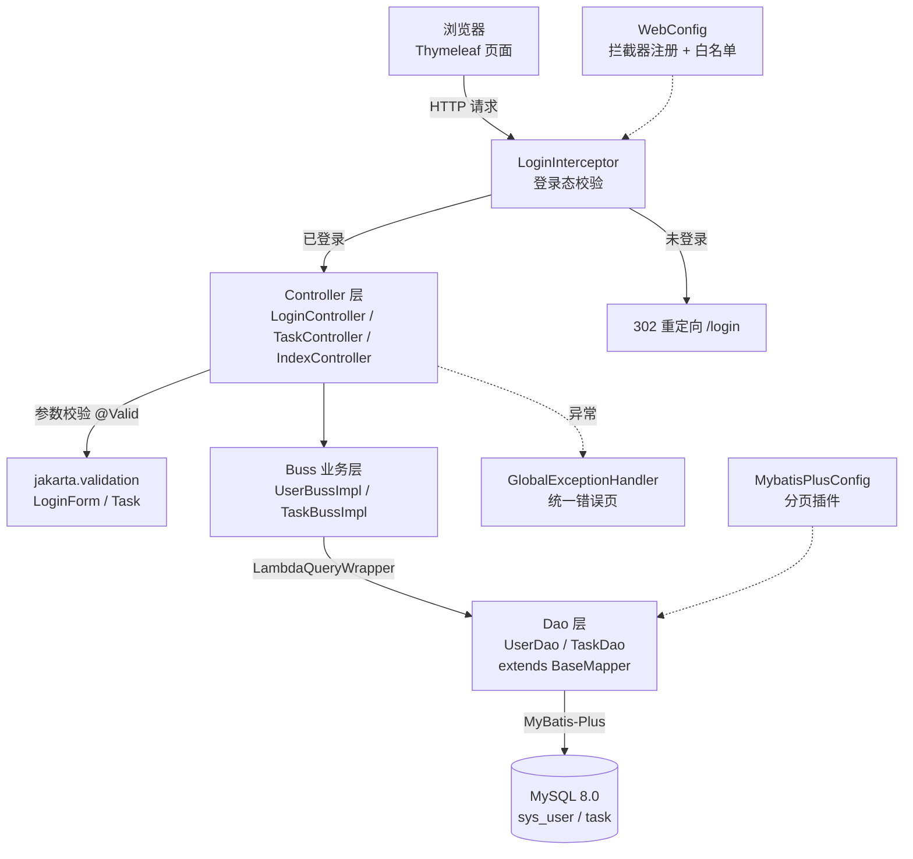
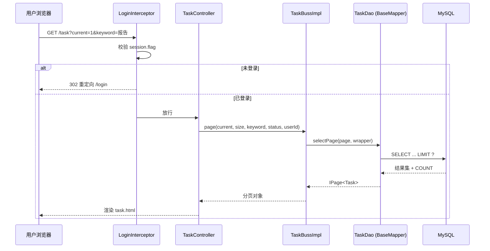

# 任务管理系统（Task Management System）

> 一个基于 **Spring Boot 3 + MyBatis-Plus + Thymeleaf + MySQL** 的服务端渲染任务管理应用。
> 从原生 Servlet + JSP 的课程项目演进而来，完整覆盖「分层架构 → 数据持久化 → 参数校验 → 统一异常 → 登录拦截 → 分页查询 → CI 流水线 → 单元测试」的工程化改造链路。


---

## 一、项目简介

本系统提供登录鉴权与任务的增删改查，核心能力包括：

- **登录鉴权**：Session 会话 + MVC 拦截器统一守卫，未登录请求自动重定向到登录页；
- **任务管理**：新增、编辑、删除、列表展示，支持优先级与状态标记；
- **条件查询与分页**：按标题/内容模糊检索、按状态筛选，分页参数由 MyBatis-Plus 分页插件生成 `LIMIT`；
- **服务端校验**：`jakarta.validation` 注解驱动，绕过前端 `required` 也能被拦截；
- **统一异常出口**：`@ControllerAdvice` 兜底，用户只看到一张错误页，堆栈仅进日志；
- **持续集成**：GitHub Actions 上 `mvn clean test` 作为质量门禁，产物 war 自动归档。

默认测试账号：`admin / 123456`（由 `schema.sql` 自动写入）。初始化脚本同时预置 5 条演示任务。

---

## 二、系统架构

### 2.1 分层结构



### 2.2 请求处理链路



---

## 三、技术栈

| 层次 | 技术 | 版本 | 说明 |
|---|---|---|---|
| 运行环境 | JDK | 17 | Spring Boot 3 的最低要求，也是 CI 使用的版本 |
| 框架 | Spring Boot | 3.3.5 | 父工程统一依赖版本，jakarta 命名空间 |
| Web | Spring MVC | 6.x | 内嵌 Tomcat，服务端渲染 |
| 模板引擎 | Thymeleaf | 3.x | `templates/*.html`，支持表单绑定与错误回显 |
| 持久层 | MyBatis-Plus | 3.5.9 | `BaseMapper` 通用 CRUD + 条件构造器 + 分页插件 |
| 分页解析 | mybatis-plus-jsqlparser | 3.5.9 | MP 3.5.9 起分页插件被拆到此可选模块 |
| 连接池 | HikariCP | Spring Boot 默认 | 未显式声明 `type`，由 starter-jdbc 自动装配，无需额外依赖 |
| 数据库 | MySQL | 8.0+ | 字符集 `utf8mb4` |
| 驱动 | mysql-connector-j | 9.7.0 | `runtime` 作用域 |
| 参数校验 | spring-boot-starter-validation | 3.3.5 | `@NotBlank` / `@Size` / `BindingResult` |
| 测试 | JUnit 5 + Mockito | 由 starter-test 管理 | 4 个测试类，37 个用例 |
| 构建 | Maven | 3.8+ | `packaging=war`，`finalName=task-servlet-demo` |
| CI | GitHub Actions | — | JDK 17 + Maven 缓存 + 测试门禁 + 产物归档 |

---

## 四、环境依赖

启动前请确认以下环境就绪：

| 依赖 | 版本要求 | 校验命令 |
|---|---|---|
| JDK | **17**（21 亦可） | `java -version` |
| Maven | 3.8 及以上 | `mvn -v` |
| MySQL | 8.0 及以上 | `mysql -uroot -p -e "select version()"` |
| 端口 | 应用 `8080`（test 档 `8081`）、数据库 `3306` | `netstat -ano \| findstr :8080` |

> 连接池说明：三个 `application-*.yml` 均**未指定** `spring.datasource.type`，由 Spring Boot 自动使用内置的
> **HikariCP**，因此 `pom.xml` 不需要额外引入 Druid 等第三方连接池依赖。启动日志出现
> `HikariPool-1 - Start completed` 即为装配成功。

---

## 五、快速开始

### 5.1 初始化数据库

```sql
-- 开发库（建库 + 建表 + admin 账号 + 5 条演示任务）
source schema.sql;
-- 测试库（内容与开发库一致，库名 task_db_test）
source schema-test.sql;
```

脚本会创建库 `task_db`（测试库 `task_db_test`）、表 `sys_user` 与 `task`，预置账号 `admin / 123456`，
并写入 5 条演示任务（3 条未完成、2 条已完成，覆盖高/中/低三种优先级）。

> 脚本中的任务插入是**非幂等**的：重复执行 `schema.sql` 会重复插入任务。
> 若库已存在、只想补数据，单独执行脚本末尾的 `SET @admin_id = ...` 与 `INSERT INTO task ...` 两段即可。

### 5.2 配置数据源

`src/main/resources/application-dev.yml` 中默认连接：

```yaml
url: jdbc:mysql://127.0.0.1:3306/task_db?useUnicode=true&characterEncoding=utf8&serverTimezone=Asia/Shanghai&useSSL=false&allowPublicKeyRetrieval=true
username: root
password: Root@123456
```

按本机实际账号密码修改，或改用环境变量覆盖。

### 5.3 启动

**方式一：Maven 直接运行（开发调试）**

```bash
mvn spring-boot:run
```

**方式二：打包运行（推荐，与 CI 产物一致）**

```bash
mvn clean package            # 产出 target/task-servlet-demo.war
java -jar target/task-servlet-demo.war
```

**方式三：IDEA 运行**

直接运行 `cn.edu.mju.band.TaskApplication#main`。

看到以下日志即为成功：

```
HikariPool-1 - Start completed.
Tomcat started on port 8080 (http)
Started TaskApplication in x.xxx seconds
```

### 5.4 访问

浏览器打开 `http://localhost:8080/login`，使用 `admin / 123456` 登录，即可看到预置的 5 条任务。

### 5.5 多环境切换

```bash
# 开发环境（默认，端口 8080，库 task_db）
java -jar target/task-servlet-demo.war

# 测试环境（端口 8081，库 task_db_test）
java -jar target/task-servlet-demo.war --spring.profiles.active=test

# 生产环境（敏感信息走环境变量，端口可由 SERVER_PORT 指定）
java -jar target/task-servlet-demo.war --spring.profiles.active=prod
```

生产档需要先设置：

```powershell
$env:DB_URL      = "jdbc:mysql://127.0.0.1:3306/task_db?useUnicode=true&characterEncoding=utf8&serverTimezone=Asia/Shanghai&useSSL=false"
$env:DB_USERNAME = "root"
$env:DB_PASSWORD = "Root@123456"
```

---

## 六、核心特性说明

| 特性 | 实现位置 | 关键点 |
|---|---|---|
| 登录鉴权 | `LoginInterceptor` + `WebConfig` | 拦截 `/**`，白名单排除登录页、静态资源与错误页；未登录 302 到 `/login` |
| 服务端校验 | `LoginForm`、`Task`、`@Valid + BindingResult` | 校验注解是唯一规则源，`BindingResult` 必须紧跟被校验对象 |
| 统一异常 | `GlobalExceptionHandler` | `BindException` → 400、`IllegalArgumentException` → 400、其余 → 500，页面不暴露堆栈 |
| 分页查询 | `TaskBussImpl#page` + `MybatisPlusConfig` | 分页插件 `maxLimit=500` 防拉库，`overflow=true` 防越界；`and(...)` 保证条件括号优先级 |
| 条件构造 | `LambdaQueryWrapper` | 字段名由方法引用解析，避免手写字符串拼 SQL |
| 主键回填 | `@TableId(type = IdType.AUTO)` | 与 DDL 的 `AUTO_INCREMENT` 对齐，插入后可直接取 `id` |
| 默认值兜底 | `TaskBussImpl#add` | `status` 缺省 0、`priority` 缺省 2，在访问持久层之前完成 |
| 环境隔离 | `application-dev/test/prod.yml` | 端口、库名、日志级别、模板缓存按环境分离 |
| 持续集成 | `.github/workflows/ci.yml` | `mvn clean test` 门禁 → `mvn package` → war 归档为 Artifact |

---

## 七、目录结构

```
task-servlet-demo/
├── .github/workflows/ci.yml        # GitHub Actions 流水线
├── docs/                           # 演进复盘、部署与验收文档
│   ├── 04-改造清单.md
│   ├── 05-三次演进复盘.md
│   ├── 06-演进仪表盘.md
│   ├── 07-部署与跨机验证.md
│   └── API.md                      # 接口手册
├── schema.sql                      # 开发库建库脚本（含预置数据）
├── schema-test.sql                 # 测试库建库脚本（含预置数据）
├── src/main/java/cn/edu/mju/band/
│   ├── TaskApplication.java        # 启动类 + @MapperScan
│   ├── controller/                 # IndexController / LoginController / TaskController
│   ├── buss/                       # 业务接口与实现
│   │   ├── TaskBuss.java
│   │   ├── UserBuss.java
│   │   └── impl/                   # TaskBussImpl / UserBussImpl
│   ├── dal/                        # TaskDao / UserDao（extends BaseMapper）
│   ├── entity/                     # Task / User
│   ├── dto/                        # LoginForm
│   ├── config/                     # WebConfig / MybatisPlusConfig
│   ├── interceptor/                # LoginInterceptor（替代原 AuthFilter）
│   └── exception/                  # GlobalExceptionHandler
├── src/main/resources/
│   ├── application.yml             # 公共配置
│   ├── application-dev.yml         # 开发环境
│   ├── application-test.yml        # 测试环境
│   ├── application-prod.yml        # 生产环境
│   ├── templates/                  # index / login / task / add_update / error
│   └── static/css/style.css
├── src/test/java/cn/edu/mju/band/  # 4 个测试类，37 个用例
└── pom.xml
```

---

## 八、测试与持续集成

### 8.1 单元测试

| 测试类 | 覆盖内容 | 数量 |
|---|---|---|
| `TaskTest` | 实体状态判断 `isFinished` | 2 |
| `TaskBussImplTest` | 业务层 CRUD、校验、分页参数 | 若干 |
| `UserBussImplTest` | 登录成功/失败、用户名空白短路 | 若干 |
| `ServiceResilienceTest` | 数据库宕机、断网等极端场景 | 若干 |

> 全部为 **纯 Mockito 单元测试**（`@ExtendWith(MockitoExtension.class)`），不启动 Spring 容器、不连接 MySQL，
> 因此云端 CI 无需声明数据库服务，构建可在数十秒内完成。

运行：

```bash
mvn clean test
```

预期输出：

```
Tests run: 37, Failures: 0, Errors: 0, Skipped: 0
BUILD SUCCESS
```

### 8.2 CI 流水线

`.github/workflows/ci.yml` 的步骤：

1. 检出代码（`actions/checkout@v4`）
2. 安装 JDK 17 + 缓存 Maven 依赖（`actions/setup-java@v4`）
3. 打印 `java -version` / `mvn -v` 作为环境证据
4. **质量门禁**：`mvn -B -ntp clean test`，失败即中断
5. 打包：`mvn -B -ntp package -DskipTests`
6. 归档 `target/*.war` 为 Artifact
7. 归档 `target/surefire-reports/` 测试报告

触发条件：push / PR 到 `master`、`main`，另支持 Actions 页面手动触发。

---

## 九、数据库设计

### 9.1 `sys_user`

| 字段 | 类型 | 约束 | 说明 |
|---|---|---|---|
| `id` | BIGINT | PK, AUTO_INCREMENT | 主键 |
| `username` | VARCHAR(50) | NOT NULL, UNIQUE | 登录名 |
| `password` | VARCHAR(100) | NOT NULL | 口令（教学示例为明文） |
| `real_name` | VARCHAR(50) | NULL | 真实姓名 |

### 9.2 `task`

| 字段 | 类型 | 约束 | 说明 |
|---|---|---|---|
| `id` | BIGINT | PK, AUTO_INCREMENT | 主键 |
| `title` | VARCHAR(120) | NOT NULL | 任务标题，长度上限与 `@Size(max=120)` 对齐 |
| `content` | VARCHAR(1000) | NULL | 任务内容 |
| `priority` | TINYINT | DEFAULT 2 | 1 低 / 2 中 / 3 高 |
| `status` | TINYINT | DEFAULT 0 | 0 未完成 / 1 已完成 |
| `task_date` | DATE | NULL | 截止日期 |
| `user_id` | BIGINT | INDEX `idx_task_user` | 所属用户 |

### 9.3 预置数据

| 标题 | 优先级 | 状态 | 截止日期 |
|---|---|---|---|
| 完成实验报告 | 高 | 未完成 | 2026-11-20 |
| 准备答辩 PPT | 中 | 未完成 | 2026-11-22 |
| 复习 JUnit5 | 中 | 已完成 | 2026-11-10 |
| 整理实验截图 | 低 | 已完成 | 2026-11-15 |
| 优化分页查询 | 高 | 未完成 | 2026-11-25 |

> `user_id` 通过 `SET @admin_id = (SELECT id FROM sys_user WHERE username='admin')` 取值，
> 不依赖自增主键恰好为 1。

---

## 十、文档索引

| 文档 | 内容 |
|---|---|
| [`docs/API.md`](docs/API.md) | 全部 HTTP 接口、参数、返回与错误码 |
| [`docs/04-改造清单.md`](docs/04-改造清单.md) | 各环节改造项清单 |
| [`docs/05-三次演进复盘.md`](docs/05-三次演进复盘.md) | 三次技术演进的复盘 |
| [`docs/07-部署与跨机验证.md`](docs/07-部署与跨机验证.md) | 部署步骤与验收清单 |

---

## 十一、已知限制

- 口令为**明文比对**（教学示例），生产环境应改为 BCrypt / Argon2 加盐哈希；
- 未引入连接池监控与 SQL 审计，仅开启 MyBatis SQL 控制台打印（dev/test 档）；
- 无 REST API 层，接口均为服务端渲染的 MVC 端点（见 `docs/API.md`）。

---

## 十二、开发约定

- 包结构固定为 `controller → buss → dal → entity`，禁止跨层直接调用；
- 新增持久层方法优先用 `BaseMapper` 通用方法 + `LambdaQueryWrapper`，不写 XML；
- 表单类校验一律用注解声明，错误回显统一走 `th:errors`；
- 提交前必须本地跑通 `mvn clean test`，CI 与本地结果需一致。
